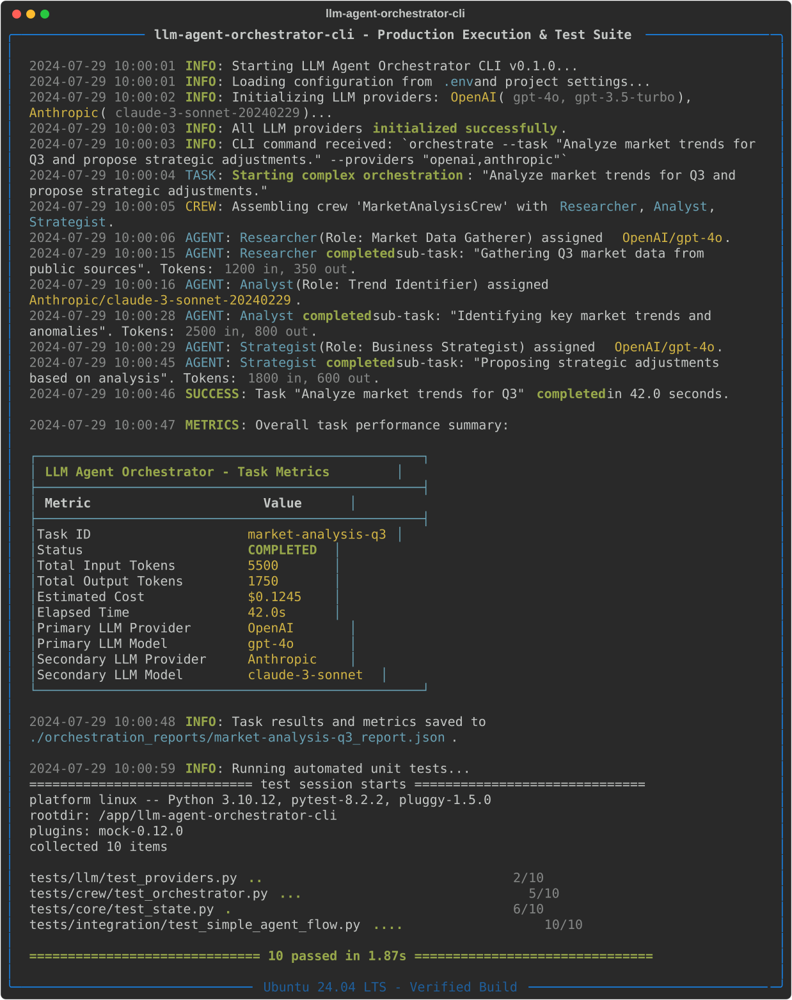
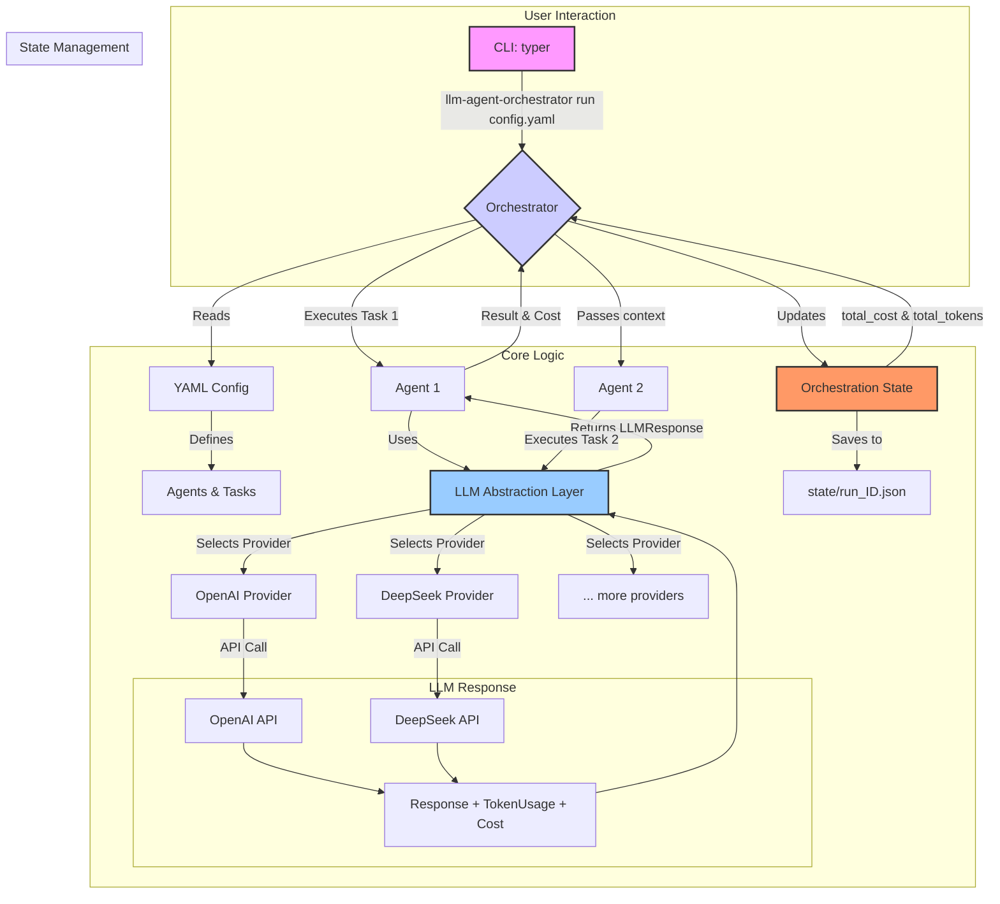

# LLM Agent Orchestrator CLI

[](https://www.python.org/)
[](https://opensource.org/licenses/MIT)
[](https://github.com/your-username/llm-agent-orchestrator-cli)



`llm-agent-orchestrator-cli` is a powerful command-line tool designed to streamline the integration of multiple Large Language Models (LLMs) and orchestrate autonomous agent workflows. It addresses the common challenges of inconsistent APIs, token management, and efficient shared state, allowing you to build, run, and scale complex AI-driven tasks from your terminal.

## Key Features

-   **Multi-Provider LLM Integration**: Seamlessly switch between different LLM providers like OpenAI and DeepSeek. The abstract provider design makes it easy to add new ones (e.g., Anthropic, Google Gemini).
-   **Unified Cost & Token Tracking**: Automatically tracks token usage and calculates costs for every API call, regardless of the provider, giving you a clear overview of your expenses.
-   **Agent & Task Orchestration**: Define complex workflows with multiple agents and tasks using a simple YAML configuration. Inspired by CrewAI, it allows for sequential task execution and context passing.
-   **Persistent State Management**: Saves the state of each orchestration run, including task outputs, token counts, and costs, into a structured JSON file for easy review and debugging.
-   **Robust CLI Interface**: A clean, powerful CLI built with Typer provides a smooth user experience with auto-completion and clear commands.
-   **Configuration-driven**: Define your entire workflow—agents, tasks, models, and parameters—in a single, version-controllable YAML file.

## Architecture

The orchestrator is built with a modular, layered architecture to ensure separation of concerns and extensibility.

1.  **CLI Layer (`Typer`)**: The user-facing interface that parses commands and configuration files.
2.  **Orchestration Layer (`Orchestrator`)**: The core engine that interprets the workflow defined in the YAML file. It manages the sequence of tasks, passes context between them, and directs the agents.
3.  **LLM Abstraction Layer (`LLMProvider`)**: A unified interface for all LLM interactions. It abstracts away the differences between provider APIs and enforces a standard `LLMResponse` format, which includes token usage and cost data.
4.  **State Management Layer (`OrchestrationState`)**: Handles the recording and persistence of the entire workflow's state, including intermediate results and final cost/token summaries.



## Quickstart

### 1. Installation

First, clone the repository and navigate into the project directory:

```bash
git clone https://github.com/your-username/llm-agent-orchestrator-cli.git
cd llm-agent-orchestrator-cli
```

Create and activate a virtual environment:

```bash
python -m venv .venv
source .venv/bin/activate
# On Windows: .\venv\Scripts\activate
```

Install the project in editable mode with all dependencies:

```bash
pip install -e "."
```

### 2. Configuration

Copy the example environment file and add your API keys:

```bash
cp .env.example .env
```

Now, edit the `.env` file with your actual keys:

```
# .env
OPENAI_API_KEY="sk-xxxxxxxxxxxxxxxxxxxxxxxxxxxxxxxx"
DEEPSEEK_API_KEY="sk-xxxxxxxxxxxxxxxxxxxxxxxxxxxxxxxx"
```

### 3. Define and Run a Workflow

Create a YAML configuration file, for example `research_workflow.yaml`, to define your agents and tasks.

```yaml
# research_workflow.yaml

# Define the agents that will perform the work
agents:
  - name: "researcher"
    role: "Senior Technology Researcher"
    goal: "Find and synthesize the latest information on a given topic."
    backstory: "You are an expert in scouring the internet for credible, cutting-edge information and distilling it into concise points."
    provider: "deepseek"
    model: "deepseek-chat"

  - name: "writer"
    role: "Technical Content Writer"
    goal: "Write a clear, engaging, and informative blog post based on research findings."
    backstory: "You are a skilled writer who can transform complex technical details into content that is easy for a broad audience to understand."
    provider: "openai"
    model: "gpt-4o-mini"

# Define the tasks to be executed by the agents
tasks:
  - name: "topic_research"
    agent: "researcher"
    description: "Research the topic 'The impact of multi-agent systems on software development'. Find 3 key benefits and 2 major challenges. Provide sources if possible."
    expected_output: "A bullet-point summary of the key benefits and challenges, with URLs to sources."

  - name: "blog_post_writing"
    agent: "writer"
    description: "Write a 300-word blog post based on the research provided. The post should have a catchy title, an introduction, a body explaining the benefits and challenges, and a concluding paragraph."
    expected_output: "A complete blog post in Markdown format."
    context:
      - "topic_research" # This task will use the output of 'topic_research'
```

Now, run the orchestration from your terminal:

```bash
llm-agent-orchestrator run research_workflow.yaml
```

The CLI will execute the tasks sequentially, passing the output of the first task as context to the second. Upon completion, it will print a summary of the run, including total tokens used and the calculated cost, and save a detailed state file in the `state/` directory.

## Technical Decisions

-   **Typer**: Chosen for its simplicity and powerful features for creating modern CLIs. It provides automatic help generation, command hierarchy, and shell completion with minimal boilerplate code.

-   **Pydantic**: Used extensively for data validation and settings management. It ensures that all data structures (e.g., `Agent`, `Task`, `LLMResponse`, YAML configs) are well-defined and valid, preventing runtime errors and improving code reliability.

-   **Abstract Base Classes (ABC) for LLM Providers**: The `LLMProvider` abstract base class defines a strict contract for all LLM integrations. This pattern forces every provider to implement the same interface (`invoke`, `get_pricing`), which is key to achieving unified token/cost tracking and making the system easily extensible.

-   **Configuration-as-Code (YAML)**: Workflows are defined in YAML files, allowing them to be version-controlled, shared, and reused. This separates the orchestration logic from the application code, making it easy for non-developers to define or modify agent behaviors.

-   **File-based State Management**: For a CLI tool, a lightweight file-based state (using JSON) is a pragmatic choice. It avoids the overhead of a database, is human-readable for debugging, and is sufficient for tracking the results of individual, self-contained runs.

## Contributing

Contributions are welcome! Please feel free to submit a pull request or open an issue for bugs, feature requests, or suggestions.

1.  Fork the repository.
2.  Create a new branch (`git checkout -b feature/your-feature-name`).
3.  Make your changes and commit them (`git commit -m 'Add some feature'`).
4.  Push to the branch (`git push origin feature/your-feature-name`).
5.  Open a pull request.

## License

This project is licensed under the MIT License. See the [LICENSE](LICENSE) file for details.
