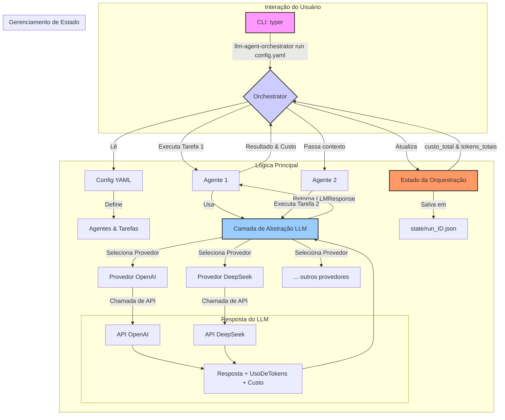

# LLM Agent Orchestrator CLI

[](https://www.python.org/)
[](https://opensource.org/licenses/MIT)
[](https://github.com/your-username/llm-agent-orchestrator-cli)


O `llm-agent-orchestrator-cli` é uma poderosa ferramenta de linha de comando projetada para simplificar a integração de múltiplos Modelos de Linguagem Grandes (LLMs) e orquestrar fluxos de trabalho de agentes autônomos. Ele resolve os desafios comuns de APIs inconsistentes, gerenciamento de tokens e estado compartilhado eficiente, permitindo que você construa, execute e escale tarefas complexas orientadas por IA diretamente do seu terminal.

## Principais Funcionalidades

-   **Integração Multi-Provedor de LLMs**: Alterne sem esforço entre diferentes provedores de LLM, como OpenAI e DeepSeek. O design de provedor abstrato facilita a adição de novos (ex: Anthropic, Google Gemini).
-   **Rastreamento Unificado de Custos e Tokens**: Rastreia automaticamente o uso de tokens e calcula os custos para cada chamada de API, independentemente do provedor, oferecendo uma visão clara de suas despesas.
-   **Orquestração de Agentes e Tarefas**: Defina fluxos de trabalho complexos com múltiplos agentes e tarefas usando uma configuração YAML simples. Inspirado no CrewAI, permite a execução sequencial de tarefas e a passagem de contexto.
-   **Gerenciamento de Estado Persistente**: Salva o estado de cada execução da orquestração, incluindo resultados de tarefas, contagem de tokens e custos, em um arquivo JSON estruturado para fácil revisão e depuração.
-   **Interface CLI Robusta**: Uma CLI limpa e poderosa, construída com Typer, proporciona uma experiência de usuário suave com preenchimento automático e comandos claros.
-   **Orientado à Configuração**: Defina todo o seu fluxo de trabalho — agentes, tarefas, modelos e parâmetros — em um único arquivo YAML, que pode ser versionado.

## Arquitetura

A orquestração é construída com uma arquitetura modular e em camadas para garantir a separação de responsabilidades e a extensibilidade.

1.  **Camada CLI (`Typer`)**: A interface voltada para o usuário que interpreta comandos e arquivos de configuração.
2.  **Camada de Orquestração (`Orchestrator`)**: O motor principal que interpreta o fluxo de trabalho definido no arquivo YAML. Ele gerencia a sequência de tarefas, passa o contexto entre elas e direciona os agentes.
3.  **Camada de Abstração de LLM (`LLMProvider`)**: Uma interface unificada para todas as interações com LLMs. Ela abstrai as diferenças entre as APIs dos provedores e impõe um formato padrão `LLMResponse`, que inclui dados de uso de tokens e custo.
4.  **Camada de Gerenciamento de Estado (`OrchestrationState`)**: Lida com o registro e a persistência do estado de todo o fluxo de trabalho, incluindo resultados intermediários e resumos finais de custo/token.



## Guia Rápido

### 1. Instalação

Primeiro, clone o repositório e navegue para o diretório do projeto:

```bash
git clone https://github.com/your-username/llm-agent-orchestrator-cli.git
cd llm-agent-orchestrator-cli
```

Crie e ative um ambiente virtual:

```bash
python -m venv .venv
source .venv/bin/activate
# No Windows: .\venv\Scripts\activate
```

Instale o projeto em modo editável com todas as dependências:

```bash
pip install -e "."
```

### 2. Configuração

Copie o arquivo de ambiente de exemplo e adicione suas chaves de API:

```bash
cp .env.example .env
```

Agora, edite o arquivo `.env` com suas chaves reais:

```
# .env
OPENAI_API_KEY="sk-xxxxxxxxxxxxxxxxxxxxxxxxxxxxxxxx"
DEEPSEEK_API_KEY="sk-xxxxxxxxxxxxxxxxxxxxxxxxxxxxxxxx"
```

### 3. Defina e Execute um Fluxo de Trabalho

Crie um arquivo de configuração YAML, por exemplo `workflow_pesquisa.yaml`, para definir seus agentes e tarefas.

```yaml
# workflow_pesquisa.yaml

# Defina os agentes que realizarão o trabalho
agents:
  - name: "pesquisador"
    role: "Pesquisador Sênior de Tecnologia"
    goal: "Encontrar e sintetizar as informações mais recentes sobre um determinado tópico."
    backstory: "Você é um especialista em vasculhar a internet por informações críveis e de ponta e resumi-las em pontos concisos."
    provider: "deepseek"
    model: "deepseek-chat"

  - name: "escritor"
    role: "Escritor de Conteúdo Técnico"
    goal: "Escrever um post de blog claro, envolvente e informativo com base nos resultados da pesquisa."
    backstory: "Você é um escritor habilidoso que pode transformar detalhes técnicos complexos em conteúdo de fácil compreensão para um público amplo."
    provider: "openai"
    model: "gpt-4o-mini"

# Defina as tarefas a serem executadas pelos agentes
tasks:
  - name: "pesquisa_topico"
    agent: "pesquisador"
    description: "Pesquise o tópico 'O impacto dos sistemas multi-agentes no desenvolvimento de software'. Encontre 3 benefícios chave e 2 desafios principais. Forneça fontes, se possível."
    expected_output: "Um resumo em tópicos dos principais benefícios e desafios, com URLs para as fontes."

  - name: "escrita_blog_post"
    agent: "escritor"
    description: "Escreva um post de blog de 300 palavras com base na pesquisa fornecida. O post deve ter um título cativante, uma introdução, um corpo explicando os benefícios e desafios, e um parágrafo de conclusão."
    expected_output: "Um post de blog completo em formato Markdown."
    context:
      - "pesquisa_topico" # Esta tarefa usará o resultado de 'pesquisa_topico'
```

Agora, execute a orquestração a partir do seu terminal:

```bash
llm-agent-orchestrator run workflow_pesquisa.yaml
```

A CLI executará as tarefas sequencialmente, passando o resultado da primeira tarefa como contexto para a segunda. Ao concluir, imprimirá um resumo da execução, incluindo o total de tokens usados e o custo calculado, e salvará um arquivo de estado detalhado no diretório `state/`.

## Decisões Técnicas

-   **Typer**: Escolhido por sua simplicidade e recursos poderosos para criar CLIs modernas. Ele fornece geração automática de ajuda, hierarquia de comandos e autocompletar de shell com o mínimo de código repetitivo.

-   **Pydantic**: Usado extensivamente para validação de dados e gerenciamento de configurações. Garante que todas as estruturas de dados (ex: `Agent`, `Task`, `LLMResponse`, configs YAML) sejam bem definidas e válidas, prevenindo erros em tempo de execução e melhorando a confiabilidade do código.

-   **Classes Base Abstratas (ABC) para Provedores de LLM**: A classe base abstrata `LLMProvider` define um contrato estrito para todas as integrações de LLM. Esse padrão força cada provedor a implementar a mesma interface (`invoke`, `get_pricing`), o que é fundamental para alcançar o rastreamento unificado de token/custo e tornar o sistema facilmente extensível.

-   **Configuração como Código (YAML)**: Os fluxos de trabalho são definidos em arquivos YAML, permitindo que sejam versionados, compartilhados e reutilizados. Isso separa a lógica de orquestração do código da aplicação, facilitando para não-desenvolvedores definir ou modificar comportamentos de agentes.

-   **Gerenciamento de Estado Baseado em Arquivos**: Para uma ferramenta CLI, um estado leve baseado em arquivos (usando JSON) é uma escolha pragmática. Evita a sobrecarga de um banco de dados, é legível por humanos para depuração e é suficiente para rastrear os resultados de execuções individuais e autocontidas.

## Como Contribuir

Contribuições são bem-vindas! Sinta-se à vontade para enviar um pull request ou abrir uma issue para bugs, solicitações de recursos ou sugestões.

1.  Faça um fork do repositório.
2.  Crie uma nova branch (`git checkout -b feature/seu-nome-de-feature`).
3.  Faça suas alterações e commite-as (`git commit -m 'Adiciona alguma feature'`).
4.  Faça o push para a branch (`git push origin feature/seu-nome-de-feature`).
5.  Abra um pull request.

## Licença

Este projeto está licenciado sob a Licença MIT. Veja o arquivo [LICENSE](LICENSE) para mais detalhes.
